# Awesome User Polling & Quick Decision Making 🗳️⚡

  

  
  
  
  
  
  
  

> 🌟 A curated collection of leading **User Polling and Quick Decision Making software** — featuring commercial SaaS audience response systems (live polling, meeting engagement, opinion scales) and production-grade self-hosted open-source alternatives for meeting scheduling, consensus deliberation, and instant anonymous voting. ✨

---

## 📑 Table of Contents

- [📈 Sector Overview & Market Dynamics](#-sector-overview--market-dynamics)
- [🟦 SaaS / Hosted Platforms](#-saas--hosted-platforms)
- [🟩 Open-Source Software](#-open-source-software)
- [📊 Comparison at a Glance](#-comparison-at-a-glance)
- [🔍 Evaluation & Selection Criteria](#-evaluation--selection-criteria)
- [💖 Support](#-support)
- [📈 Star History](#-star-history)
- [🤝 Contributing](#-contributing)
- [📄 License](#-license)

---

## 📈 Sector Overview & Market Dynamics

The global market for audience response systems, interactive polling, and live engagement software is valued at approximately **$2.5B to $4.2B** 💰, expanding within the broader **$25B+** enterprise customer and workforce engagement software industry at an expected **7% to 15% CAGR** 🚀. The sector exhibits a **moderately fragmented landscape at the point-solution tier** 🧩 (with specialized standalone tools competing fiercely across live presentation polls, scheduling matrices, and micro-surveys), while **consolidating at the enterprise level** 🏢 as digital workplace giants (Cisco's acquisition of Slido, TX Group's ownership of Doodle, and Goldman Sachs' buy-privatization of Kahoot!) absorb top engagement tools into unified enterprise suites.

---

## 🟦 SaaS / Hosted Platforms

Below is a detailed benchmark of commercial, cloud-hosted User Polling and Quick Decision Making platforms sorted in descending order by estimated company valuation / annual revenue:

| 🏷️ Platform | 💼 Company Valuation / Revenue | 💳 Starting Paid Tier Price | 🎁 Free Tier Limits & Details | 🎯 Key Features & Focus |
|:---|:---|:---|:---|:---|
| **Kahoot!** 🎮 | **$1.7B** *(Acquired by Goldman Sachs PE consortium; >$150M ARR)* | **$19/month** *(Kahoot! 360 Pro Start, billed annually; personal/study plans from $3.99/mo)* | **Permanently free (Kahoot! Go)**: Capped at **10 players** per live session (or up to 40 players for verified K-12 school teachers; free business trial limited to 3 players). | Gamified live quizzes, interactive team competitions, trivia leaderboards, and corporate training challenges. 🏆 |
| **Doodle** 📅 | **~$1.1B** *(Parent TX Group market cap; Doodle ARR estimated >$20M)* | **$11/user/month** *(Pro plan billed annually; or $15/month billed monthly)* | **Permanently free**: Ad-supported plan capped at **1 active group poll**, max **10 time slots per poll**, 1 booking page, and 1 active 1:1 meeting. | World-recognized calendar scheduling polls for groups, meeting availability polling, and automated booking pages. ⏱️ |
| **Typeform (Opinion Scale)** 📝 | **$935M** *(Valuation post Series C; ~$70M–$90M+ ARR)* | **$28/month** *(Basic plan billed annually; or $39/month billed monthly)* | **Permanently free**: Capped at **10 responses per month** across all active forms, 10 questions per form, and includes Typeform branding. | Conversational form surveys, 1-10 opinion scale polling, Net Promoter Score (NPS) collection, and interactive web flows. 💬 |
| **Mentimeter** 📊 | **$384M** *(Valuation; ~$60M ARR)* | **$11.99/presenter/month** *(Basic plan billed annually at $144/year)* | **Permanently free**: Capped at **50 participants per month**; provides unlimited slide decks, presentations, and core question formats. | Live interactive presentation slides, word clouds, audience Q&A, rating scales, and real-time visualization. ☁️ |
| **Slido** 🎤 | **$70B+ (Parent Cisco)** *(Estimated Slido standalone ARR ~$20M–$26M)* | **$12.50/month** *(Engage plan billed annually at $150/year for 1 user)* | **Permanently free (Basic)**: Capped at **100 participants per event**, up to **3 polls per event**, and 1 quiz (max 30 questions per event). | Real-time meeting Q&A, upvoting, live audience polls, Webex/Teams/Zoom integrations, and enterprise summits. 💡 |
| **Polly for Teams** 🤖 | **~$8.2M total venture funding** *(Estimated ARR ~$5M–$8M)* | **$24/sender/month** *(Standard team tier billed annually; or $29/month monthly)* | **Permanently free**: Capped at **25 total responses per month**, 30-day results history, basic scheduling, and default poll templates. | Native in-chat polling, standup retrospectives, quick pulse checks, and surveys directly inside Microsoft Teams and Slack. 💬 |
| **Poll Everywhere** 📱 | **Bootstrapped** *(Estimated ARR ~$11M–$12M)* | **$10/month** *(Present plan billed annually at $120/year; or $84/mo for multi-user Engage)* | **Permanently free (Intro Plan)**: Capped at **40 responses per activity/poll**, unlimited questions, and 10 AI poll generator prompts/month. | Live audience polling via web/SMS, presentation slide add-ins (PowerPoint, Keynote, Google Slides), and word clouds. 📡 |
| **StrawPoll** 🗳️ | **Bootstrapped / Independent** *(Estimated ARR ~$1M–$2M)* | **$10/month** *(Ad-free premium creator plan with extended analytics)* | **Permanently free**: **Unlimited polls and unlimited votes/participants**; ad-supported, with duplicate vote prevention capped at 1,000 voters. | Instant anonymous polling with no user registration required, real-time vote visualization, and embeddable widgets. 🔗 |

---

## 🟩 Open-Source Software

Self-hosted, transparent, and privacy-respecting User Polling and Quick Decision Making software. Repositories are sorted in descending order by GitHub stargazer count:

### 1. [lukevella/rallly](https://github.com/lukevella/rallly) 🌟
  
**Tech Stack:** Next.js / TypeScript / Prisma / PostgreSQL / Tailwind CSS | **License:** AGPL-3.0 ⚖️  
Rallly is the leading open-source alternative to Doodle and When2meet for **scheduling polls**. Create a poll with proposed dates and times, share the link, and participants can mark their availability without creating accounts. Features include an intuitive availability grid, discussion comments, email notifications, calendar invite finalization, and support for 10+ languages. 🌐  
- 🎯 **Best for:** Teams and organizations needing a self-hosted meeting scheduler without participant account barriers.

### 2. [loomio/loomio](https://github.com/loomio/loomio) 🌟
  
**Tech Stack:** Ruby on Rails / Vue.js / PostgreSQL / Docker | **License:** AGPL-3.0 ⚖️  
Loomio is an established open-source collaborative decision-making platform designed to help organizations, cooperatives, and communities make decisions together. It supports rich polling formats including consensus voting, proposal consent, dot-voting, ranked-choice (instant-runoff), and time-limited deliberations. 🤝  
- 🎯 **Best for:** Distributed teams, DAOs, cooperatives, and non-profits seeking structured group consensus and formal decision making.

### 3. [decidim/decidim](https://github.com/decidim/decidim) 🌟
  
**Tech Stack:** Ruby on Rails / Node.js / PostgreSQL / Docker | **License:** AGPL-3.0 ⚖️  
Decidim is a participatory democracy and civic polling framework developed for governments, public institutions, and large associations. It allows organizations to host public consultations, participatory budgeting votes, citizen assemblies, and verifiable decision processes. 🏛️  
- 🎯 **Best for:** Municipalities, civic organizations, universities, and large communities running large-scale voting consultations.

### 4. [ClaperCo/Claper](https://github.com/ClaperCo/Claper) 🌟
  
**Tech Stack:** Elixir / Phoenix / LiveView / WebSockets | **License:** AGPL-3.0 ⚖️  
Claper is an open-source, real-time alternative to Slido, AhaSlides, and Mentimeter for **live audience engagement**. Presenters can upload slides or create presentations, while audience members join via QR code on mobile devices to submit questions, upvote Q&A topics, vote in live polls, and express emoji reactions in real time. 👏  
- 🎯 **Best for:** Conference speakers, workshop facilitators, and educators wanting a self-hosted live interactive presentation tool.

### 5. [fsinfuhh/Bitpoll](https://github.com/fsinfuhh/Bitpoll) 🌟
  
**Tech Stack:** Python / Django / PostgreSQL / Docker | **License:** GPL-3.0 ⚖️  
Bitpoll (originally developed at TU Wien / FSInf) is a self-hosted polling application for coordinating dates, meeting times, and multi-choice questions. It provides both anonymous and authenticated voting, fine-grained access tokens, and a clean interface without third-party tracking. 🔒  
- 🎯 **Best for:** Academic faculties and privacy-centric groups looking for a clean, Python-based Doodle alternative.

### 6. [devmahmud/Django-Poll-App](https://github.com/devmahmud/Django-Poll-App) 🌟
  
**Tech Stack:** Python / Django / Bootstrap / SQLite / PostgreSQL | **License:** MIT ⚖️  
A full-featured polling web application built with Django. It provides authentication, poll creation, choice management, vote tracking with duplicate vote prevention, search filtering, and real-time result percentage calculation. 🐍  
- 🎯 **Best for:** Developers looking for a customizable, battle-tested Python/Django base for embedding polling systems into existing portals.

### 7. [nextcloud/polls](https://github.com/nextcloud/polls) 🌟
  
**Tech Stack:** PHP / Vue.js / TypeScript / Nextcloud App API | **License:** AGPL-3.0 ⚖️  
An official community app for Nextcloud that turns any self-hosted cloud instance into an event-scheduling and opinion-polling hub. Features include anonymous or public voting, integration with Nextcloud address books and calendar invitations, access control, and encrypted shares. ☁️  
- 🎯 **Best for:** Existing Nextcloud users and organizations wanting integrated meeting polls and survey collection without separate servers.

### 8. [hartwork/jawanndenn](https://github.com/hartwork/jawanndenn) 🌟
  
**Tech Stack:** Python / Django / React / TypeScript / SQLite / Docker | **License:** AGPL-3.0 ⚖️  
Jawanndenn is a lightweight, libre web application designed specifically to schedule meetings and coordinate group decisions without requiring accounts or tracking user cookies. Supports date picking, custom option voting, and instant Docker deployment. ⏱️  
- 🎯 **Best for:** Individuals and small sysadmin teams looking for a low-resource scheduling poll tool.

### 9. [framasoft/framadate](https://github.com/framasoft/framadate) 🌟
  
**Tech Stack:** PHP / MariaDB / JavaScript | **License:** CeCILL-B (GPL-compatible) ⚖️  
Framadate is the long-standing French libre polling platform developed by the non-profit Framasoft. It allows anyone to create meeting availability polls or generic multi-choice decision polls with custom expiration dates and link-based voting. 🥖  
- 🎯 **Best for:** Non-profits and educational bodies seeking a proven, battle-tested PHP polling tool.

### 10. [manfredsteger/polly](https://github.com/manfredsteger/polly) 🌟
  
**Tech Stack:** React / Express / Node.js / PostgreSQL / Docker | **License:** MIT ⚖️  
A modern self-hosted polling and scheduling application designed for teams. Supports schedule polls, booking lists, and multi-question surveys with email-based voter verification, real-time WebSocket results, ICS calendar exports, and PWA capabilities. ⚡  
- 🎯 **Best for:** Modern engineering teams wanting an integrated scheduling and survey tool with WebSocket updates.

### 11. [Rishi-ZAiFi/open.mentimeter](https://github.com/Rishi-ZAiFi/open.mentimeter) 🌟
  
**Tech Stack:** React / Node.js / Socket.io / CSS3 | **License:** MIT ⚖️  
A local-first, zero-cloud alternative to Mentimeter designed to run offline over local area networks (LAN) or portable Wi-Fi hotspots. Features include presenter view, live multiple-choice quizzes with timer speed bonuses, word clouds, and anonymous Q&A upvoting. 📶  
- 🎯 **Best for:** Offline workshops, field training, and privacy-sensitive air-gapped environments.

### 12. [imambujshukla7/prashna](https://github.com/imambujshukla7/prashna) 🌟
  
**Tech Stack:** Node.js / Express / React / WebSockets | **License:** MIT ⚖️  
A local-first live audience Q&A and quiz software platform designed for interactive town halls, webinars, and classroom lectures with anonymous audience voting and upvoting. ❓  
- 🎯 **Best for:** Interactive lecture sessions needing anonymous audience feedback and quick quiz evaluations.

### 13. [nearbycoder/qikpoll](https://github.com/nearbycoder/qikpoll) 🌟
  
**Tech Stack:** TypeScript / Bun / React 19 / Redis / WebSockets | **License:** MIT ⚖️  
A lightweight StrawPoll-style application built for high-speed, no-signup polling with live WebSocket updates, Redis TTL expiration, anti-repeat vote guardrails, and an MCP (Model Context Protocol) API endpoint for AI agents. 🚀  
- 🎯 **Best for:** Developers looking for modern Redis-backed live polling and AI agent integration.

### 14. [danielhn/librepolls](https://github.com/danielhn/librepolls) 🌟
  
**Tech Stack:** PHP / Laravel / Docker Compose | **License:** AGPL-3.0 ⚖️  
A privacy-respecting self-hosted StrawPoll alternative that allows creating instant multi-choice polls with IP and browser-based anti-ballot stuffing mechanisms without requiring participant accounts. 🛡️  
- 🎯 **Best for:** Minimalist self-hosted quick community polling.

---

## 📊 Comparison at a Glance

| 🛠️ Tool | 📁 Category | 🚀 Deployment | ⚖️ License | 👤 No-Account Voting | 🔄 Real-Time Sync | 💡 Primary Use Case |
|:---|:---|:---|:---|:---:|:---:|:---|
| **Kahoot!** | SaaS | Cloud | Proprietary | ✅ | ✅ | Gamified classroom & corporate team quizzes 🎮 |
| **Doodle** | SaaS | Cloud | Proprietary | ✅ | Async | Business meeting scheduling & availability 📅 |
| **Typeform** | SaaS | Cloud | Proprietary | ✅ | Async | Conversational rating scale surveys & NPS 📝 |
| **Mentimeter** | SaaS | Cloud | Proprietary | ✅ | ✅ | Interactive presenter slides & live audience polling 📊 |
| **Slido** | SaaS | Cloud | Proprietary | ✅ | ✅ | Enterprise town hall Q&A and meeting polls 🎤 |
| **Polly for Teams** | SaaS | Cloud / Native | Proprietary | ❌ (Teams/Slack) | ✅ | Workplace chat standups, pulse checks, & team polls 🤖 |
| **Poll Everywhere** | SaaS | Cloud | Proprietary | ✅ | ✅ | Slide presentation add-ins & live audience feedback 📱 |
| **StrawPoll** | SaaS | Cloud | Proprietary | ✅ | ✅ | Instant anonymous single-link public polls 🗳️ |
| **Rallly** | Open-Source | Self-Hosted / Docker | AGPL-3.0 | ✅ | Async | Clean Doodle alternative for group availability 🗓️ |
| **Loomio** | Open-Source | Self-Hosted / Docker | AGPL-3.0 | ❌ (Account/Invite) | ✅ | Consensus voting, proposals, & cooperative governance 🤝 |
| **Decidim** | Open-Source | Self-Hosted / Docker | AGPL-3.0 | ❌ (Civic Auth) | ✅ | Public citizen assemblies & participatory democracy 🏛️ |
| **Claper** | Open-Source | Self-Hosted / Docker | AGPL-3.0 | ✅ | ✅ (LiveView) | Modern Slido/Mentimeter alternative for live talks 👏 |
| **Bitpoll** | Open-Source | Self-Hosted / Docker | GPL-3.0 | ✅ | Async | Lightweight privacy-first meeting scheduling 🔒 |
| **Django-Poll-App** | Open-Source | Self-Hosted / Django | MIT | ❌ (Auth) | Async | Extensible Python voting engine 🐍 |
| **Nextcloud Polls** | Open-Source | Nextcloud App | AGPL-3.0 | ✅ | Async | Internal organization & calendar-integrated polls ☁️ |
| **Jawanndenn** | Open-Source | Self-Hosted / Docker | AGPL-3.0 | ✅ | Async | Minimalist no-cookie date scheduling ⏱️ |
| **Framadate** | Open-Source | Self-Hosted / PHP | CeCILL-B | ✅ | Async | Non-profit appointment & group decision voting 🥖 |
| **Polly (manfred)** | Open-Source | Self-Hosted / Docker | MIT | ✅ (Email) | ✅ (WebSockets) | Modern team polling, booking lists, & surveys ⚡ |
| **open.mentimeter** | Open-Source | Local-First / LAN | MIT | ✅ | ✅ (Socket.io) | Offline Wi-Fi live quizzes & word clouds 📶 |
| **Prashna** | Open-Source | Local / Node.js | MIT | ✅ | ✅ (WebSockets) | Local-first audience Q&A and live quiz sessions ❓ |
| **QikPoll** | Open-Source | Self-Hosted / Bun | MIT | ✅ | ✅ (WebSockets) | Fast anonymous real-time Redis polling & MCP API 🚀 |
| **Librepolls** | Open-Source | Self-Hosted / Docker | AGPL-3.0 | ✅ | Async | Simple self-hosted StrawPoll alternative 🛡️ |

---

## 🔍 Evaluation & Selection Criteria

When choosing between commercial SaaS and self-hosted open-source polling solutions, evaluate:

1. **Participation Friction** 🚀: Does the tool allow instant responses via QR code or direct URL without forcing participants to register an account? (e.g., Rallly, Claper, StrawPoll).
2. **Synchronous vs. Asynchronous Workflows** ⏱️: 
   - *Synchronous (Live Events)*: Requires low-latency WebSockets / Server-Sent Events for instant slide and leaderboard feedback (Slido, Mentimeter, Claper, open.mentimeter).
   - *Asynchronous (Scheduling & Consensus)*: Requires timezone conversion, calendar integration (.ics), and structured proposal voting (Doodle, Rallly, Loomio).
3. **Data Privacy & Compliance** 🛡️: Organizations with strict GDPR, HIPAA, or air-gap constraints require self-hosted on-premises or local-first architectures (open.mentimeter, Bitpoll, Nextcloud Polls).
4. **Anti-Ballot-Stuffing Safeguards** 🔐: Support for IP throttling, browser fingerprinting, single-use email tokens, or SSO/OAuth integration to maintain vote integrity.

---

## 💖 Support

Thank you so much for exploring and supporting this curated resource! 🙏  
If you find this list helpful, please consider:
- ⭐ **Starring** this repository to help others discover it!
- 🍴 **Forking** and contributing new tools or corrections.
- 📢 **Sharing** with your colleagues, dev teams, and community.
- ☕ **Buying a coffee / sponsoring** the author to support ongoing open-source curation and development:

  

---

##  Star History

---

## 🤝 Contributing

Contributions are warmly welcome! 🌟 If you know of an awesome User Polling or Quick Decision Making platform that belongs here:

1. Fork this repository 🍴.
2. Add your suggestion to the appropriate section or table with valid project metadata, pricing/license details, and GitHub links 🔗.
3. Open a Pull Request following conventional commit guidelines 🚀.

---

## 📄 License

This repository is distributed under the [Creative Commons Zero v1.0 Universal License (CC0-1.0)](LICENSE) 📜. All individual software projects listed retain their respective commercial or open-source licenses.
